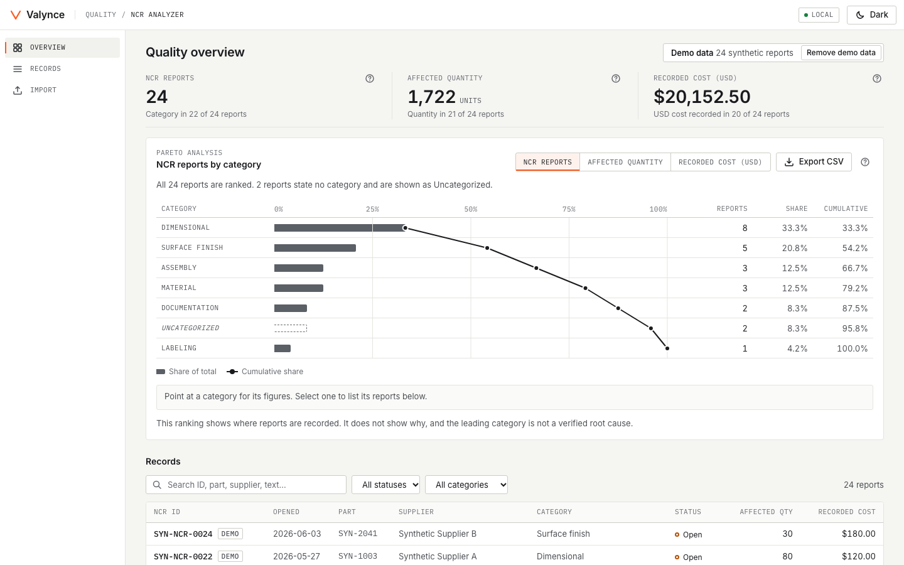
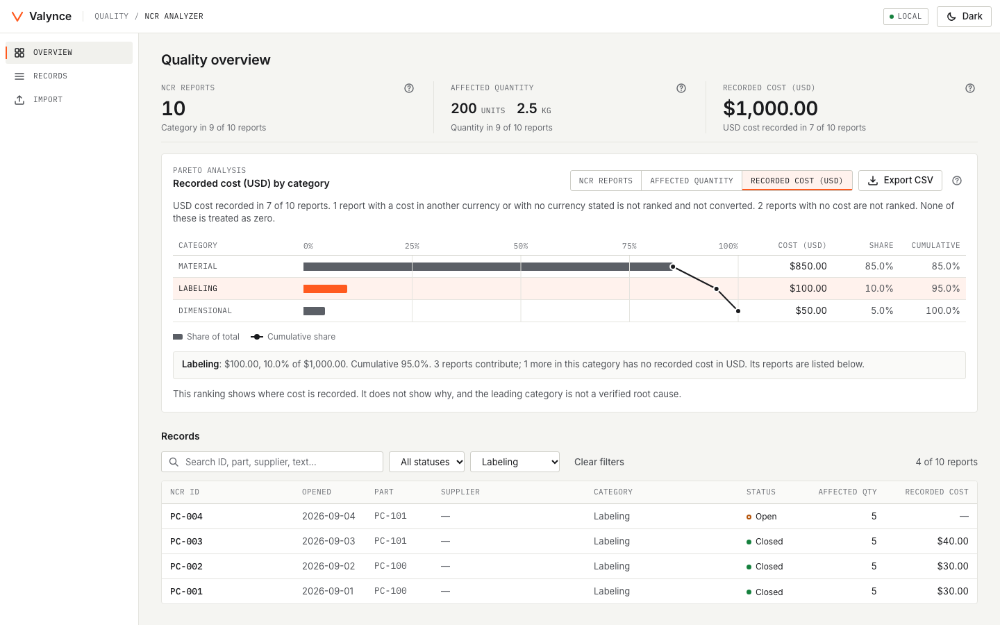
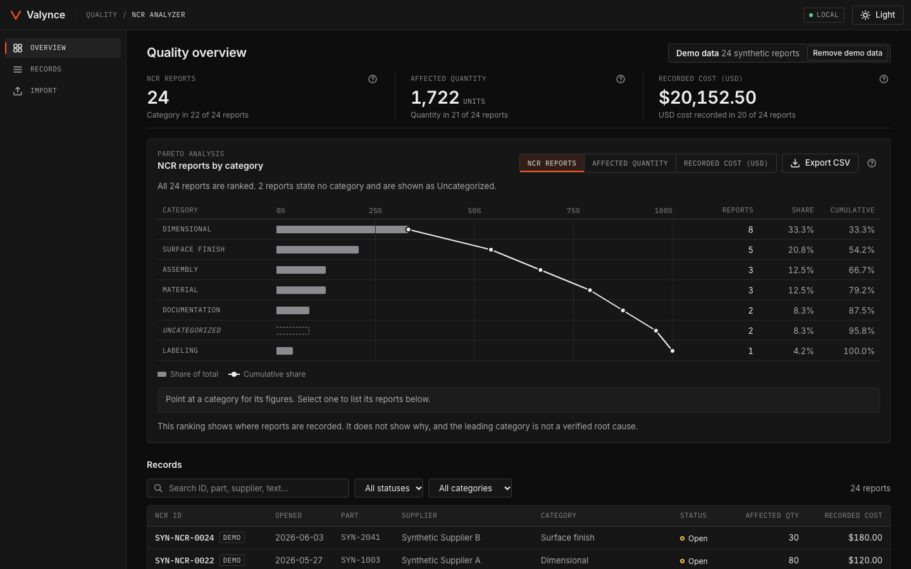
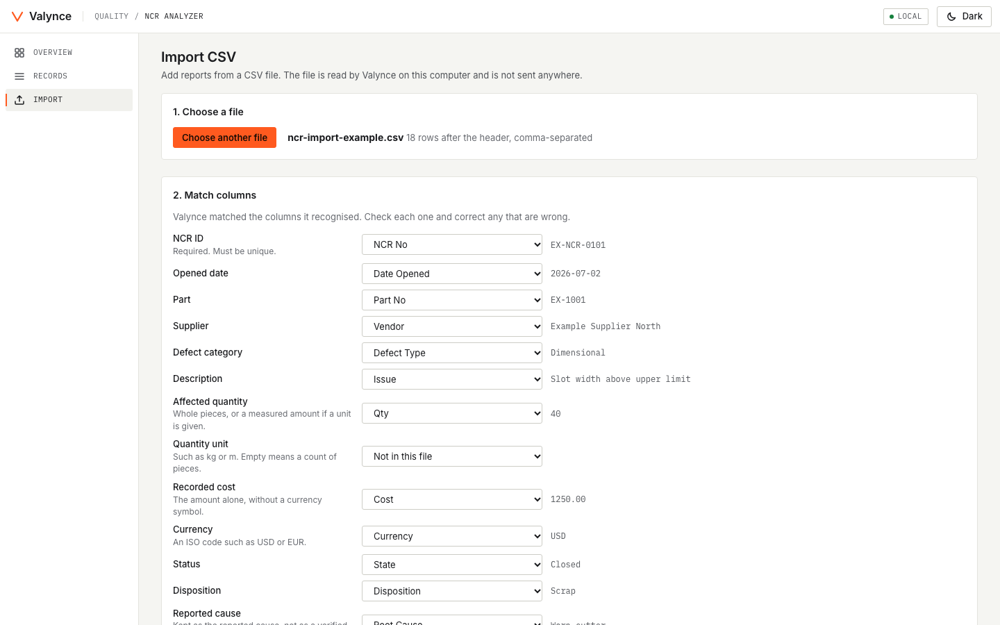
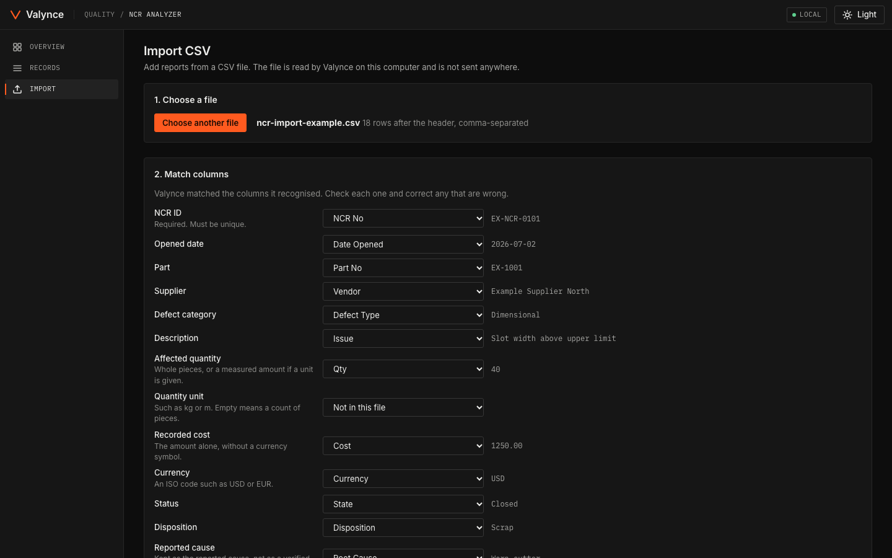
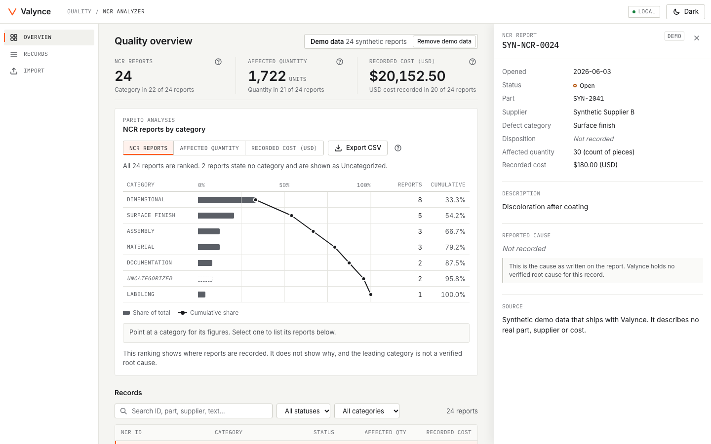
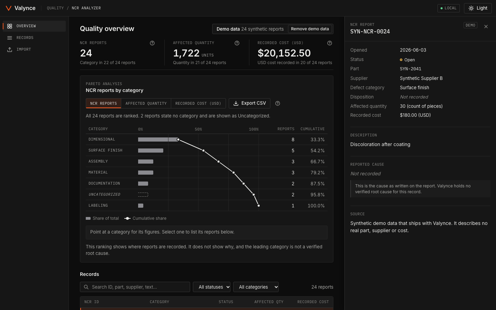

<h1 align="center">Valynce</h1>

<p align="center">
  <strong>Local-first quality analysis for manufacturers.</strong>
</p>

<p align="center">
  Import your non-conformance reports (NCRs) from CSV, see which defect categories matter most by report count,
  affected quantity or recorded cost, and trace every figure back to the row it came from.<br />
  It runs on your own computer. Your records are not sent anywhere.
</p>

<p align="center">
  Built by <a href="https://paulshahidi.com">Paul Shahidi, PhD</a>, former Apple and Anduril engineering leader, building manufacturing tools in public.
</p>

<p align="center">
  <a href="https://github.com/icareon/valynce/actions/workflows/ci.yml"></a>
  <a href="https://github.com/icareon/valynce/releases"></a>
  <a href="LICENSE"></a>
  
</p>

<p align="center">
  <a href="https://github.com/icareon/valynce/releases/download/v0.1.0-alpha.5/valynce-pareto-demo.mp4">
    
  </a>
</p>

<p align="center">
  <a href="https://github.com/icareon/valynce/releases/download/v0.1.0-alpha.5/valynce-pareto-demo.mp4"><strong>Watch the 20-second demo</strong></a>:
  the same ten reports ranked three ways, with a different category on top each time.<br />
  <sub>Every screenshot and the demo use synthetic data that ships with the project. The video was recorded with <code>v0.1.0-alpha.5</code>, before the summary was restyled.</sub>
</p>

---

## Quick start

Requires **Node.js 24.15.0 or newer** and git.

```bash
git clone https://github.com/icareon/valynce.git
cd valynce
npm ci
npm run build
npm start
```

Open [http://127.0.0.1:4310](http://127.0.0.1:4310). Press `Ctrl+C` in the terminal to stop.

A new installation starts empty. From there:

- **Load demo data** adds 24 synthetic reports, clearly tagged, which you can remove again with one click.
- **Import** takes a CSV file. To see the Pareto analysis at its clearest, import [`fixtures/pareto-check.csv`](fixtures/pareto-check.csv), then switch the metric on the Overview. Labeling leads by report count, Dimensional by affected quantity and Material by recorded cost.

To run exactly the tagged alpha, check it out before installing: `git checkout v0.1.0-alpha.6`.

Valynce is not published to npm yet, so there is no `npx` command.

## What it does today

| | |
|---|---|
| **CSV import and validation** | Matches columns by header, lets you correct the mapping, and shows what every row will do before anything is stored. Each rejected row is listed with its row number and reason. |
| **No guessing** | A date such as `03/04/2026` or a number such as `1,234` can be read two ways. When the file does not settle it, you choose, and the preview shows how each number will be read. |
| **Source traceability** | Each imported report keeps its file name, row number and original cells. An import can be undone, which removes exactly the reports it added. |
| **Pareto analysis** | Ranks defect categories by NCR count, affected quantity or recorded cost, with share of total and cumulative share. Select a category to list its reports. |
| **Nothing added that cannot be** | Pieces are never added to kilograms: each unit gets its own total and ranking. Cost totals and the cost ranking show US dollars only for now. A cost in another currency, or with no currency stated, is kept exactly as recorded and counted beside the figure; it is never converted or treated as zero. |
| **Light and dark themes** | Switch from the top right. The choice is remembered on your computer. |
| **Local persistence** | Reports live in a SQLite database on your machine and survive restarts and updates. |
| **CSV export** | Exports the ranking on screen, using the same reports as the chart. |

<p align="center">
  
</p>

## Light and dark

| Light | Dark |
|---|---|
|  |  |
|  |  |
|  |  |

## Your data stays on your computer

- **Local only.** The server listens on `127.0.0.1`, so other machines cannot reach it. It refuses requests under other host names and writes coming from other websites.
- **No outside requests.** Fonts are bundled. The app contacts nothing but its own local server, and there is no telemetry.
- **Where the database lives.** In your per-user data folder, outside the project folder, so updating or deleting the project does not touch your records:

  | System | Folder |
  |---|---|
  | macOS | `~/Library/Application Support/Valynce` |
  | Linux | `~/.local/share/valynce` (or `$XDG_DATA_HOME/valynce`) |
  | Windows | `%APPDATA%\Valynce` |

  Set `VALYNCE_DATA_DIR` to use another folder and `VALYNCE_PORT` to change the port, in your shell or in a `.env` file copied from [`.env.example`](.env.example).
- **Backups.** When a newer version needs to change the database's structure, it first saves an untouched copy beside it, named like `valynce.db.v3.bak`. There are no scheduled backups: to make your own, stop Valynce and copy `valynce.db`.

## What the numbers mean

| Term | Meaning |
|---|---|
| **NCR count** | The number of reports. Each report counts once, however many units it covers. |
| **Affected quantity** | The quantity the reports say was affected. With no unit it is a whole count of pieces; with a unit of measure such as kg it may be fractional. |
| **Recorded cost** | The cost written on the reports. It is not an estimate of the total cost of poor quality. |
| **Share / cumulative** | A category's part of the total of the values that were recorded, and the running sum of those parts down the ranking. |
| **Reported cause** | The cause as written on the report. Valynce does not treat it as verified. |

Three rules hold everywhere:

- **Missing is not zero.** A value that was not recorded is shown as "—" or "Not recorded" and is left out of sums. Every total and every chart says how many reports it covers.
- **Nothing is assumed.** A cost with no stated currency is shown as "Currency unspecified". It is never taken to be dollars and never added to costs in a known currency. If a file has no currency column, you can tick "All costs in this file are USD" during import; Valynce does not do it for you.
- **A ranking is not a cause.** The Pareto chart shows where reports, quantity or cost are recorded. It does not show why, and the leading category is not a verified root cause.

## Alpha limitations

This is an early alpha, `v0.1.0-alpha.6`. Expect rough edges.

- **Checked on one platform.** Development and automated checks ran on macOS with Chrome. Windows, Linux desktops, Safari, Firefox and screen readers have not been checked by hand. CI runs installation, type checking, tests and the build on Linux.
- **CSV only, UTF-8 only.** Files need a header row and comma, semicolon or tab separators, up to 20 MB. Excel workbooks are not read.
- **No editing.** Reports cannot be edited or added by hand, only imported or removed with their import.
- **Duplicates are skipped.** A row whose NCR ID is already stored is reported and left out. There is no option to update a stored report from a file.
- **Export is the ranking only.** Exporting the reports themselves is not built yet.
- **One grouping.** The Pareto chart groups by defect category only.
- **Cost analysis in USD only.** The cost total and cost ranking cover costs stated in US dollars. Other currencies are stored and listed, and counted as left out, but not totalled or ranked yet.
- **Built-in SQLite.** Storage uses Node's `node:sqlite` module, which Node labels a release candidate.
- **No AI features.** See below.

## Roadmap

Planned, not built. Order may change.

1. An optional summary of the analysis that cites the report IDs it is based on, sent to a model only when you ask.
2. Export of the reports themselves.
3. A packaged launcher, so the app starts with one command.

## How it is built

TypeScript throughout: a React interface built with Vite, a small Hono server on Node, and SQLite for storage. Quality rules, storage, interface and server are kept in separate folders, described in [AGENTS.md](AGENTS.md).

**Valynce contains no AI features today.** No model is called and no summary is generated. AI coding agents assisted in writing the code, working under the rules in [AGENTS.md](AGENTS.md) and checked by the tests and browser checks in this repository.

## Contributing

Bug reports and ideas are welcome. Please read [CONTRIBUTING.md](CONTRIBUTING.md) first, and use only synthetic or sanitized examples: this repository is public and must never hold real customer data.

## License

[MIT](LICENSE) © 2026 Paul Shahidi. Bundled fonts and libraries keep their own licenses, listed in [THIRD_PARTY_NOTICES.md](THIRD_PARTY_NOTICES.md).
