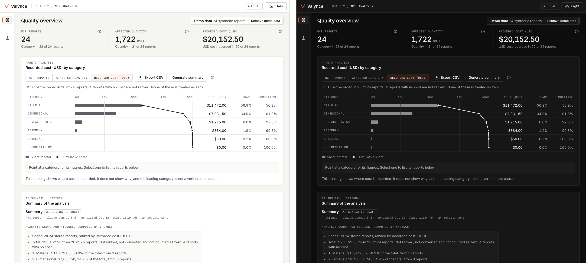

# Valynce

[](https://github.com/icareon/valynce/actions/workflows/ci.yml)
[](https://github.com/icareon/valynce/releases)
[](https://nodejs.org/)
[](LICENSE)

Local-first analysis of non-conformance reports (NCRs) for manufacturers: import your reports, see where they concentrate, and trace every figure back to its source records.



<sub>The same view in both themes, with Valynce's synthetic demo data. The summary shown was generated by a real, confirmed request.</sub>

## What it does

- **CSV import with mapping and validation.** Map your columns, see every row's outcome and the reason for each rejection, and resolve ambiguous dates and number formats before anything is stored.
- **Pareto analysis by three metrics.** Rank defect categories by number of reports, affected quantity or recorded USD cost, with each category's share and cumulative share. Missing values are counted beside the figure, never treated as zero.
- **Source records and export.** Select a category to list the reports behind it, open any report to see its original file row, and export the ranking as CSV.
- **Optional AI summary.** Draft a short, evidence-linked summary of the analysis on screen. Each finding is marked as fact or hypothesis and cites report IDs you can click.

## Workflow

1. **Import** a CSV of NCRs, or load the 24 synthetic demo reports.
2. **Compare priorities** by switching the ranking between reports, quantity and cost.
3. **Inspect the evidence** by selecting a category and opening its reports.
4. **Optionally generate a summary**, after reviewing exactly what would be sent.

## Run locally

Requires Node.js 24.15.0 or newer and git.

```bash
git clone https://github.com/icareon/valynce.git
cd valynce
npm ci
npm run build
npm start
```

Open [http://127.0.0.1:4310](http://127.0.0.1:4310). A new installation starts empty; choose **Load demo data** on the start screen.

## Optional AI summary

The summary uses Anthropic's API and is off until you add your own key:

```bash
cp .env.example .env      # then set ANTHROPIC_API_KEY in .env
npm start
```

`.env` is git-ignored. The key stays in the local server process; it is never sent to the browser or written to the database. There is no offline AI: without a key the feature is simply unavailable, and everything else works.

## Your data

Analysis is local. Records are stored in a database on your computer, and in normal use the app makes no external network requests. Installing it downloads its dependencies from npm.

The AI summary is the one exception, and only when you ask. Choosing **Generate summary** first shows the provider, the model, the number of reports and the fields that would be sent and withheld. Data leaves your computer only when you confirm that view, for that one request. Nothing is sent on import, on start-up or in the background.

## Limitations

Valynce is an early alpha. It was developed and checked on macOS with Chrome, with installation, tests and the build also run on Linux in CI; Windows, Safari and Firefox are unchecked. It reads CSV files only, and cost analysis covers costs recorded in USD. An AI summary is a draft that requires human review: automated checks reject replies that cite unknown reports, attach a figure to the wrong report or category, or claim a root cause, but they do not guarantee factual accuracy, and a sentence can still misread a report. The summary has been run against the live model on small synthetic datasets only.

## More

- [Reference](docs/REFERENCE.md): where the database lives, what each number means, what an AI request contains, the live-check result and the full list of limitations.
- [Contributing](CONTRIBUTING.md) and the [project rules](AGENTS.md).
- Licensed under [MIT](LICENSE). Bundled fonts and libraries are listed in [THIRD_PARTY_NOTICES.md](THIRD_PARTY_NOTICES.md).
